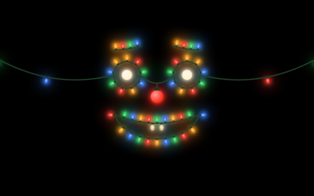
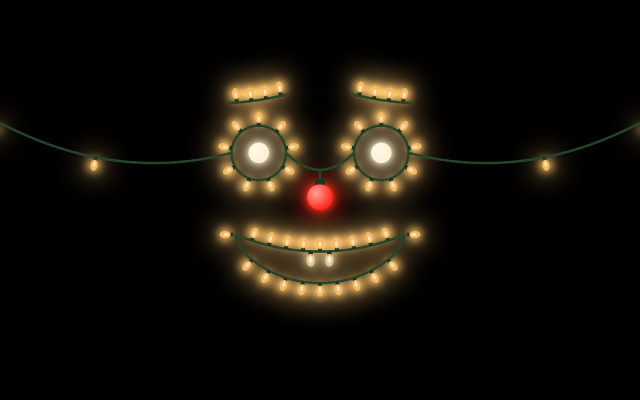

# Christmas Lights and Snowman

A Christmas voice skin for [Kiosk Satellite](https://github.com/jxlarrea/kiosk-satellite) with two faces to choose from. While it is picked, the assistant is a face strung from Christmas lights, or a snowman, instead of the usual overlay.

| Christmas lights (default) | Snowman |
| --- | --- |
|  |  |

## Christmas lights

A face strung from old-fashioned bulbs on a green cord, with lead cords running off the sides of the screen. The eyes are rings of bulbs with warm white pupils, and the nose is a red bulb.

- **Listening:** it leans in and raises its brows, and the bulbs flash with your voice.
- **Thinking:** the lights chase round the whole face, the eyes glance up and aside, and one brow goes up.
- **Answering:** the mouth drops open with the answer, two bulb teeth show, and the mouth's bulbs pulse with each word.

## Snowman

A snowman's head with coal eyes, a carrot nose, a top hat and a red scarf, with snow falling round him.

- **Listening:** he leans in, your voice blows the snow about and his hat bumps on loud words.
- **Thinking:** the snow swirls round his head, he looks up and aside, squints and his carrot wiggles.
- **Answering:** the thin line joining his coal smile opens into a mouth that moves with the answer.

What you said and the answer show under the face, as with the built-in skins. Docked overlay mode shows a small face beside the conversation.

## Requirements

- Kiosk Satellite 2026.10.30 or later (the first release with plugin voice skins)
- The native Voice Satellite runtime turned on. Skins draw only its turns.

## Installation

### Community Plugins (Recommended)

Once it is listed in [Community Plugins](https://kiosksatellite.com/plugins/), use the button below to open it in your Kiosk Satellite and install it.

Or search for `Christmas Lights and Snowman` in **Settings > Plugin Manager > Browse plugins** in Kiosk Satellite.

### Manual

1. Open **Settings > Plugin Manager** in Kiosk Satellite and turn on **Enable Plugins**.
2. Choose **Add plugin**, paste `https://github.com/dlarkinsPonderosa/kiosk-christmas-skin` and choose **Preview**.
3. Review the plugin and choose **Trust and install**, then enable it.

### Pick the skin

Open **Settings > Voice Satellite > Appearance > Skin** and pick **Christmas Lights and Snowman**. **Preview** shows it for five seconds.

When Christmas is over, pick your usual skin again.

## Settings

| Setting | What it does |
| --- | --- |
| Face | **Christmas lights** (default) or **Snowman**. |
| Frame rate | **Auto** (default) draws at the screen's full rate and drops to 30 frames a second if the device can't keep up. **Full** never drops. **30 frames a second** always caps it; pick it for slow devices such as the Echo Show 5. |
| Bulbs | Christmas lights only. **Multicolour** (default) or **Warm white**. The pupils, nose and teeth keep their own colours. |
| Bulb glow | Christmas lights only. The soft light round each bulb. On by default. |
| Background | Snowman only. **Snowy night** (default) is a dark blue sky with moonlight behind him; **Black** is plain black. Snow falls in both. |

The skin also follows **Voice Satellite > Appearance**: Background sets how much of the dashboard shows through, Text size scales the conversation, and with Reactive activity bar off nothing moves with the voice. Both faces are made for a dark screen, so Theme does not change them.

## Data

The plugin reads only the kiosk's own Voice Satellite state: whether its skin is picked, the voice level, the phase of the turn and the words shown on screen. It sends nothing anywhere and does not talk to Home Assistant.

## Build

GitHub Actions builds a test ZIP on every push (**Actions > Build**) for **Plugin Manager > Developer Tools > Install from ZIP**. Publishing a release tagged with the version, such as `v1.0.0`, runs **Release**, which attaches the files Kiosk Satellite installs.

To build locally: Python 3, JDK 17 or newer and an Android SDK with `platforms;android-35` and `build-tools;35.0.0`, then `python3 tools/build.py --android-platform 35`.

`tools/render_art.py` redraws the icon, the Skin picker thumbnail and the README pictures from the same geometry as `Lights.java` and `Snowman.java`.

The SDK under `sdk/` and the build tools under `tools/` come from [kiosk-satellite-plugins](https://github.com/jxlarrea/kiosk-satellite-plugins) (Apache-2.0).

## License

[Apache-2.0](LICENSE)
